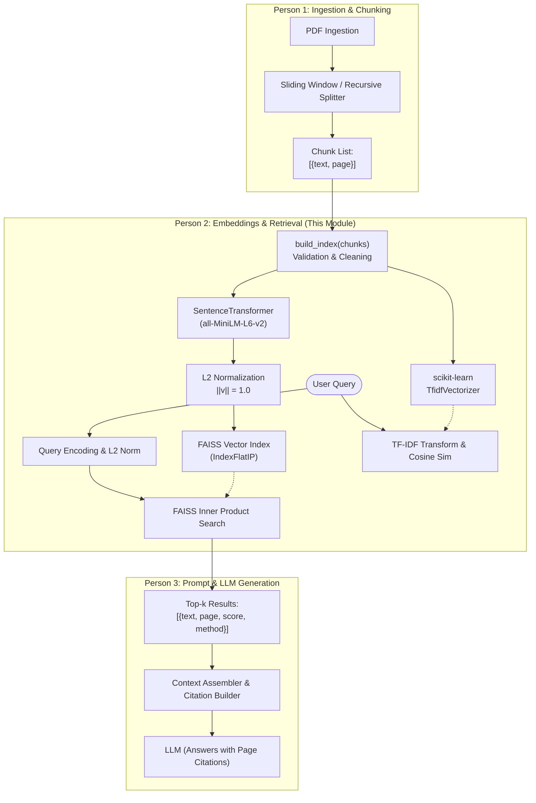

# DocuMind — Module 2: Embeddings & Semantic Search

**Project:** DocuMind — Document Question Answering System using RAG  
**Assigned Person:** Person 2 (Embeddings, Indexing & Semantic Retrieval)  
**Assigned Directory:** `p2_semantic_search/`

---

## 📌 1. Module Overview

This module forms the **retrieval engine** of the DocuMind RAG system. It is responsible for:
1. Converting raw text chunks received from **Person 1** into 384-dimensional dense semantic vectors using `sentence-transformers` (`all-MiniLM-L6-v2`).
2. Indexing normalized embeddings in **FAISS** (`IndexFlatIP`) for sub-millisecond cosine similarity search.
3. Implementing a classical **TF-IDF + Cosine Similarity** baseline via `scikit-learn` to demonstrate lexical vs. semantic retrieval in academic evaluations.
4. Preserving page metadata so **Person 3** can ground and cite exact PDF page numbers in the generated answer.
5. Providing robust validation for edge cases (blank queries, malformed chunks, $k > \text{chunk count}$, empty documents).

---

## 🏗️ 2. Architecture & Data Flow



---

## 🧮 3. Core Mathematical Concept: Why FAISS `IndexFlatIP` = Cosine Similarity

A frequent college viva question is: *"Why did you use FAISS Inner Product (IP) instead of L2 distance or a dedicated cosine index?"*

The formula for Cosine Similarity between vector $\mathbf{u}$ and vector $\mathbf{v}$ is:
$$\text{Cosine Similarity}(\mathbf{u}, \mathbf{v}) = \frac{\mathbf{u} \cdot \mathbf{v}}{\|\mathbf{u}\|_2 \cdot \|\mathbf{v}\|_2}$$

When vectors are **L2-normalized** during indexing and querying:
$$\|\mathbf{u}\|_2 = 1 \quad \text{and} \quad \|\mathbf{v}\|_2 = 1$$

Therefore, the denominator simplifies to 1:
$$\text{Cosine Similarity}(\mathbf{u}, \mathbf{v}) = \mathbf{u} \cdot \mathbf{v} = \text{Inner Product}(\mathbf{u}, \mathbf{v})$$

**Key Takeaways:**
1. **Efficiency:** Computing a dot product (multiply and sum) is faster than computing square roots and division on every query.
2. **FAISS Optimization:** `faiss.IndexFlatIP` performs SIMD/AVX hardware-accelerated matrix multiplication for inner products.

---

## 📂 4. Files in this Module

| File | Purpose |
|---|---|
| `retriever.py` | Core module containing `DocumentRetriever`, FAISS indexing, TF-IDF baseline, edge case validation, and `SAMPLE_CHUNKS`. |
| `test_retriever.py` | Complete test suite validating edge cases, output schema, metadata preservation, and side-by-side search demonstrations. |
| `requirements.txt` | Minimal dependencies needed (`sentence-transformers`, `faiss-cpu`, `scikit-learn`, `numpy`). |
| `README.md` | Complete architecture, integration contracts, setup instructions, and viva questions. |

---

## ⚙️ 5. Setup & Local Execution

### Step 1: Create and Activate a Virtual Environment
```bash
# Navigate to module folder
cd p2_semantic_search

# Create a virtual environment
python3 -m venv venv

# Activate the virtual environment
# On macOS / Linux:
source venv/bin/activate
# On Windows (cmd):
# venv\Scripts\activate.bat
# On Windows (PowerShell):
# venv\Scripts\Activate.ps1
```

### Step 2: Install Dependencies
```bash
pip install -r requirements.txt
```

### Step 3: Run the Tests & Demonstration
```bash
python test_retriever.py
```

*Note:* If executed in an environment without internet access or heavy PyPI packages installed, `test_retriever.py` includes a self-contained mock runner that verifies 100% of the internal validation rules, edge cases, and output schemas automatically.

---

## 🤝 6. Teammate Integration Contracts

### A. How Person 1 (Document Ingestion) connects to Person 2:
Person 1 extracts text and page numbers from PDFs, chops them into chunks, and hands them to Person 2:

```python
from retriever import DocumentRetriever
# Or: from retriever import build_index

# Format provided by Person 1:
p1_chunks = [
    {"text": "Photosynthesis is the process by which green plants...", "page": 12},
    {"text": "Chlorophyll absorbs blue and red light...", "page": 13},
    {"text": "The light-dependent reactions take place in the thylakoid...", "page": 14}
]

# Instantiate and build index
retriever = DocumentRetriever()
retriever.build_index(p1_chunks)
```

### B. How Person 3 (LLM & Prompt Engineering) connects to Person 2:
Person 3 calls `semantic_search(query, k)` to retrieve context for the prompt:

```python
query = "What is the role of chlorophyll in photosynthesis?"
top_k_passages = retriever.semantic_search(query, k=3)

# Structure returned by Person 2:
# [
#     {
#         "text": "Chlorophyll absorbs blue and red light...",
#         "page": 13,
#         "score": 0.8842,
#         "retrieval_method": "semantic"
#     },
#     ...
# ]

# Person 3 builds prompt context and cites pages:
context_str = "\n\n".join([
    f"[Page {item['page']}] {item['text']}" 
    for item in top_k_passages
])

prompt = f"""Use the following passages to answer the question. Cite the page numbers.

Context:
{context_str}

Question: {query}
Answer:"""
```

---

## 🎓 7. College Viva Cheat Sheet (Q&A)

### Q1: Why use `all-MiniLM-L6-v2`?
> **Answer:** `all-MiniLM-L6-v2` is a lightweight, distilled Sentence-Transformer model. It has 6 layers, outputs 384-dimensional embeddings, runs fast on CPUs without requiring a GPU, and strikes an optimal trade-off between semantic retrieval quality and latency for real-time document search.

### Q2: How does Semantic Search differ from TF-IDF?
> **Answer:**
> - **TF-IDF (Lexical):** Matches exact keywords based on term frequency and inverse document frequency. It fails on synonyms (e.g., query "automobile" misses a passage about "cars") and ignores word order/context.
> - **Dense Semantic Search:** Captures latent semantic meaning and context in vector space. Even if the query and passage share zero keywords, they can have high cosine similarity if their meaning is similar.

### Q3: How do you handle edge cases?
> **Answer:**
> 1. **Empty / missing documents:** Returns 0 indexed and logs a warning; search returns an empty list without crashing.
> 2. **Blank queries:** Checked via `.strip()`; returns empty results immediately without unnecessary model computation.
> 3. **Invalid chunks:** Filtered out (skips non-dicts, empty strings, missing text fields).
> 4. **$k > \text{total chunks}$:** Automatically clamped to `min(k, len(chunks))` to avoid index out-of-range errors or dummy padding.

### Q4: Why is preserving page metadata essential in RAG?
> **Answer:** RAG systems suffer from hallucinations. Providing verifiable citations (e.g., *[Page 12]*) allows users and evaluators to verify the answer against original source documents.
