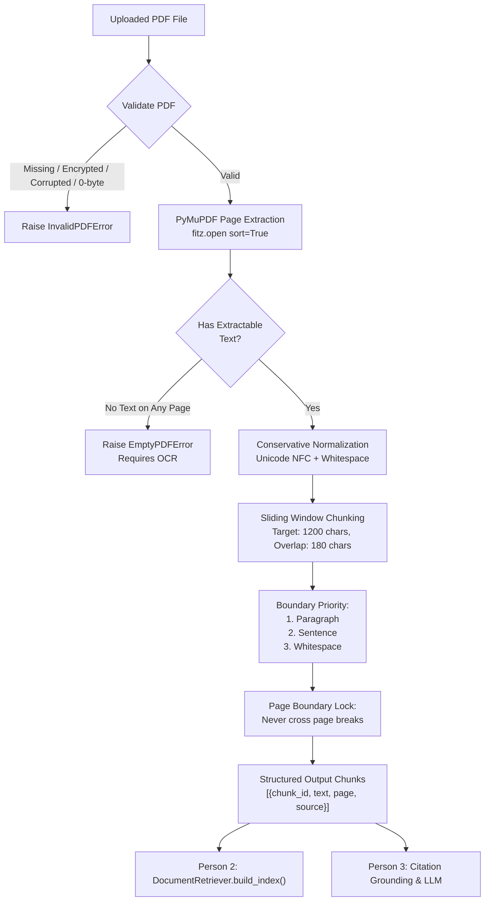

# DocuMind — Module 1: PDF Processing & NLP Preprocessing

> **Document Ingestion, Unicode Normalization, and Page-Preserving Semantic Chunking for Retrieval-Augmented Generation (RAG).**

- **Project:** DocuMind — Document Question Answering System using RAG
- **Assigned Person:** Person 1 (Document Pipeline & Text Ingestion)
- **Assigned Module:** `backend/pdf_processor.py`
- **Agreed Output Target:** Chunks with 1-based page numbers for Person 2 (retriever) and Person 3 (citations)

---

## 📌 1. Module Overview

Module 1 serves as the **ingestion gateway** of the DocuMind RAG architecture. Before dense vector embeddings can be generated or similarity indices can be built, raw document files must be converted into clean, consistent, and context-rich text passages.

### Key Responsibilities:
1. **Document Validation:** Verifies file existence, `.pdf` extension, non-zero file size, 50 MB upper limit, password protection status, and file readability before processing.
2. **Page-by-Page Extraction:** Leverages PyMuPDF (`fitz`) to extract text in natural reading order while tracking strict 1-based page numbers.
3. **Conservative Text Cleaning:** Applies Unicode NFC normalization, non-breaking space replacement, and control character elimination while preserving mathematical symbols, punctuation, and paragraph structures.
4. **Boundary-Aware Chunking:** Segments long page texts into overlapping chunks (default: 1,200 chars target with 180 chars overlap), prioritizing paragraph and sentence boundaries.
5. **Citation Integrity Guarantee:** **Chunks never cross page boundaries.** This ensures every retrieved passage can be unambiguously attributed to a specific page for academic grounding.

---

## 🏗️ 2. Ingestion Pipeline Architecture



---

## 📦 3. Data Schema & Integration Contract

Person 1 produces a structured dictionary from `process_pdf(file_path)`:

```python
{
    "document": "research_paper.pdf",
    "page_count": 3,
    "pages_with_text": 3,
    "total_characters": 4041,
    "chunk_count": 6,
    "chunks": [
        {
            "chunk_id": "69a97a3179-p1-c1",
            "text": "DocuMind: Accurate Document Question Answering using...",
            "page": 1,
            "source": "research_paper.pdf",
            "char_start": 0,
            "char_end": 1087
        },
        ...
    ]
}
```

### Downstream Consumption:
- **Person 2 (Retriever):** Calls `retriever.build_index(result["chunks"])`. Person 2 utilizes the `text` field for SentenceTransformer embeddings and TF-IDF matrices, and retains `page` and `source` for result ranking.
- **Person 3 (Generator):** When Person 2 returns top-$k$ passages, Person 3 formats prompts with `[Page X]` tags and validates that generated answers only cite pages present in the retrieved chunks.
- **Person 4 (UI / Integration):** Receives the top-level summary (`page_count`, `total_characters`, `chunk_count`) to display ingestion feedback in the web dashboard.

---

## 📂 4. Files in this Module

| File | Description |
|---|---|
| `backend/pdf_processor.py` | Core pipeline implementation (`validate_pdf`, `extract_pdf_pages`, `clean_text`, `chunk_pages`, `process_pdf`, CLI runner). |
| `backend/__init__.py` | Package initializer providing clean, lazy exports. |
| `pdf_processor.py` | Root-level CLI and module wrapper for convenient top-level access. |
| `tests/test_pdf_processor.py` | Comprehensive test suite covering valid docs, scanned docs, encryption, chunk sizes, and edge cases (12 passing tests). |
| `test_pdf_processor.py` | Root-level test discoverer. |
| `sample_pdfs/create_sample_pdf.py` | Helper script to generate multi-page academic test PDFs. |
| `sample_pdfs/research_paper.pdf` | Realistic 3-page research paper PDF for testing. |
| `demo_p1_p2_pipeline.py` | End-to-end demonstration linking Person 1's ingestion to Person 2's FAISS retriever. |
| `requirements-p1.txt` | Dedicated minimal dependencies for Person 1 (`PyMuPDF`, `pytest`). |
| `requirements.txt` | Unified team requirements including both Person 1 and Person 2 dependencies. |

---

## ⚙️ 5. Setup & Local Execution

### Step 1: Create and Activate Virtual Environment
```bash
# In documind-semantic-search root:
python -m venv .venv

# On Windows (PowerShell):
.\.venv\Scripts\Activate.ps1
# On Windows (CMD):
.\.venv\Scripts\activate.bat
# On Linux / macOS:
source .venv/bin/activate
```

### Step 2: Install Dependencies
```bash
# Minimal install for Person 1 only:
pip install -r requirements-p1.txt

# Or full team install:
pip install -r requirements.txt
```

### Step 3: Run Automated Unit Tests
```bash
python -m pytest tests/test_pdf_processor.py -v
```
*Expected result: 12 passing tests.*

### Step 4: Process a PDF via Command Line
```bash
python -m backend.pdf_processor sample_pdfs/research_paper.pdf
```
Options:
- `--chunk-size 1000`: Target character size per chunk.
- `--overlap 150`: Overlap character count.
- `--preview 5`: Number of chunk previews to display in terminal.

### Step 5: Run the End-to-End P1 + P2 Integration Demo
```bash
python demo_p1_p2_pipeline.py
```
This runs the full pipeline: PDF ingestion -> FAISS vector indexing -> Semantic search + TF-IDF search.

---

